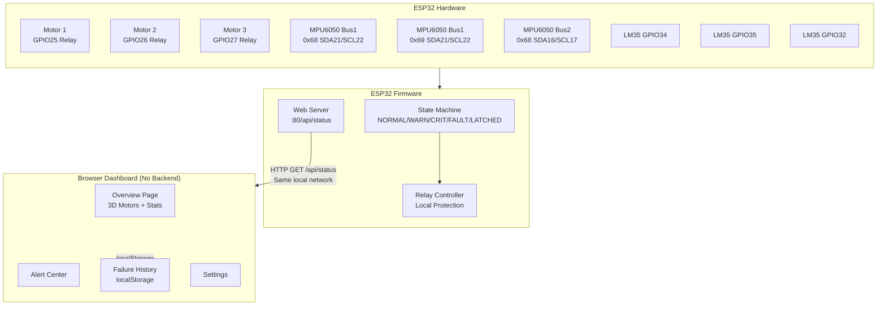

# SmartPredict — Predictive Maintenance System

> **⚠️ IMPORTANT SAFETY NOTICE**
> This project controls real electrical relays and motors. All thresholds are **UNCALIBRATED** and are examples only.
> You **must** verify every wiring connection, calibrate thresholds, and test in a safe, isolated environment before using this system on real machinery.
> Physical wiring diagrams in this document have **not been physically verified**. Always compare pin labels on your actual hardware modules with this document before making any connections.

---

## Table of Contents

1. [Project Overview](#1-project-overview)
2. [Hardware List](#2-hardware-list)
3. [GPIO Mapping](#3-gpio-mapping)
4. [MPU6050 Wiring (Two I2C Buses)](#4-mpu6050-wiring-two-i2c-buses)
5. [LM35 Temperature Sensor Wiring](#5-lm35-temperature-sensor-wiring)
6. [Relay Module Wiring](#6-relay-module-wiring)
7. [Motor Supply Wiring](#7-motor-supply-wiring)
8. [Power Supply and Common Ground](#8-power-supply-and-common-ground)
9. [Relay Polarity Verification](#9-relay-polarity-verification)
10. [LM35 Pinout and Voltage Warnings](#10-lm35-pinout-and-voltage-warnings)
11. [Two-I2C-Bus Explanation](#11-two-i2c-bus-explanation)
12. [Arduino IDE Setup and Libraries](#12-arduino-ide-setup-and-libraries)
13. [Firmware Upload Steps](#13-firmware-upload-steps)
14. [Dashboard Setup and Usage](#14-dashboard-setup-and-usage)
15. [ESP32 Address Configuration](#15-esp32-address-configuration)
16. [Export and Restore History](#16-export-and-restore-history)
17. [Testing Warnings and Critical Shutdown](#17-testing-warnings-and-critical-shutdown)
18. [Known Limitations and Troubleshooting](#18-known-limitations-and-troubleshooting)

---

## 1. Project Overview

SmartPredict monitors three small DC motors in real time using:
- **MPU6050** IMU sensors — vibration RMS, peak, and acceleration data
- **LM35** analog temperature sensors — motor temperature in °C
- **Relay modules** — independent motor on/off control with fault latching

The system protects motors locally on the ESP32, even without Wi-Fi or dashboard connectivity.

A browser-based dashboard provides:
- Live motor health scores, temperature, and vibration charts
- Per-motor 3D animated model showing real-time state
- Warning and critical alerts with evidence-based fault reasons
- Persistent failure history stored in browser `localStorage`
- JSON and CSV export/import for history backup

```
SmartPredict/
├── firmware/
│   └── SmartPredict_ESP32.ino   ← All ESP32 code in one file
├── dashboard/
│   ├── index.html               ← Open this in your browser
│   ├── style.css
│   └── app.js
└── README.md
```

### Architecture



---

## 2. Hardware List

| Component | Quantity | Notes |
|-----------|----------|-------|
| ESP32 DevKit V1 | 1 | 30-pin or 38-pin variant |
| MPU6050 GY-521 module | 3 | I2C IMU; includes onboard 3.3V regulator |
| LM35DZ temperature sensor | 3 | TO-92 package; **not LM35D** (different pinout on some variants) |
| 5V relay module (active-low) | 3 | Optocoupler-isolated modules recommended |
| Small DC motor | 3 | Voltage rating must match your external power supply |
| Breadboard / PCB | — | |
| Jumper wires | — | |
| External DC power supply | 1 | For motors; voltage matched to motor specs |
| USB cable | 1 | For programming and ESP32 power |
| 100 nF bypass capacitors | 3+ | One per LM35, across VCC and GND |
| 4.7 kΩ pull-up resistors | 2 sets | One pair per I2C bus (may be on MPU6050 module) |

> **⚠️ Check your relay module datasheet:** Some relay modules are active-HIGH. Set `RELAY_ACTIVE_LOW = false` in the firmware if your module activates on HIGH.

---

## 3. GPIO Mapping

> **DO NOT change these assignments** without reviewing the full wiring guide. These are locked in both firmware and hardware.

### Pin Mapping Table

| Function | GPIO | Notes |
|----------|------|-------|
| I2C Bus 1 — SDA | 21 | Motor 1 and Motor 2 MPU6050 |
| I2C Bus 1 — SCL | 22 | Motor 1 and Motor 2 MPU6050 |
| I2C Bus 2 — SDA | 16 | Motor 3 MPU6050 |
| I2C Bus 2 — SCL | 17 | Motor 3 MPU6050 |
| Motor 1 LM35 analog | 34 | Input-only GPIO; no output possible |
| Motor 2 LM35 analog | 35 | Input-only GPIO; no output possible |
| Motor 3 LM35 analog | 32 | Supports ADC |
| Motor 1 Relay | 25 | DAC-capable; outputs 3.3V drive |
| Motor 2 Relay | 26 | DAC-capable; outputs 3.3V drive |
| Motor 3 Relay | 27 | Outputs 3.3V drive |

### MPU6050 I2C Addresses

| Motor | Bus | AD0 pin | I2C Address |
|-------|-----|---------|-------------|
| Motor 1 | Bus 1 (GPIO21/22) | GND | 0x68 |
| Motor 2 | Bus 1 (GPIO21/22) | 3.3V | 0x69 |
| Motor 3 | Bus 2 (GPIO16/17) | GND | 0x68 |

---

## 4. MPU6050 Wiring (Two I2C Buses)

### Bus 1 — Motor 1 and Motor 2

```
ESP32           MPU6050 (Motor 1)     MPU6050 (Motor 2)
GPIO21 (SDA) ──┬── SDA                SDA ──┐
GPIO22 (SCL) ──┼── SCL                SCL ──┤── ESP32 GPIO22
3.3V         ──┼── VCC                VCC ──┼── ESP32 3.3V
GND          ──┼── GND                GND ──┼── ESP32 GND
               │   AD0 → GND          AD0 → 3.3V
               └── (shared bus) ──────┘
```

- Motor 1 MPU6050: **AD0 connected to GND** → address 0x68
- Motor 2 MPU6050: **AD0 connected to 3.3V** → address 0x69
- Pull-up resistors (4.7 kΩ) from SDA and SCL to 3.3V (may be present on module)

### Bus 2 — Motor 3

```
ESP32           MPU6050 (Motor 3)
GPIO16 (SDA) ── SDA
GPIO17 (SCL) ── SCL
3.3V         ── VCC
GND          ── GND
               AD0 → GND           → address 0x68
```

> **Important:** GPIO16 and GPIO17 are used as software I2C on Bus 2. The firmware initializes both buses independently using the `TwoWire` class. Do not connect Motor 3 to Bus 1.

---

## 5. LM35 Temperature Sensor Wiring

> **⚠️ LM35 Voltage Warning:** The LM35DZ output voltage must never exceed the ESP32 ADC input voltage (3.3V). At 150°C the LM35 outputs 1.5V, which is safe. However, if your LM35 is powered by 5V and you use a TO-92 variant with a different pinout, you could damage GPIO pins. Verify your LM35 variant and pinout before wiring.

### LM35DZ TO-92 Pinout (Flat face toward you, pins pointing down)

```
     LM35DZ (flat side facing you)
     ┌─────────────┐
     │             │
    [1]  [2]  [3]
     │    │    │
    VCC  OUT  GND
```

> **⚠️ Verify this pinout against your actual LM35 datasheet.** Some LM35 variants and counterfeit parts may have different pin ordering.

### Wiring

| LM35 | ESP32 |
|------|-------|
| Motor 1 VCC | 3.3V |
| Motor 1 OUT | GPIO34 |
| Motor 1 GND | GND |
| Motor 2 VCC | 3.3V |
| Motor 2 OUT | GPIO35 |
| Motor 2 GND | GND |
| Motor 3 VCC | 3.3V |
| Motor 3 OUT | GPIO32 |
| Motor 3 GND | GND |

- Place a **100 nF ceramic capacitor** between VCC and GND of each LM35
- Place the LM35 as close to the motor body as practical for accurate readings
- Use heat-resistant wire or kapton tape to secure the sensor to the motor

### Temperature Formula

```
ADC range: 0–4095 (12-bit)
Reference: 3.3V
Formula: Temp(°C) = (ADC × 3300 / 4095) / 10 + CALIBRATION_OFFSET
```

> All offsets are **UNCALIBRATED**. Measure actual temperature with a reference thermometer and adjust `LM35_OFFSET[]` in the firmware.

---

## 6. Relay Module Wiring

> **⚠️ Relay polarity:** Most 5V relay modules with optocouplers are **active-LOW** (IN pin LOW = relay energized). Set `RELAY_ACTIVE_LOW = true` in the firmware. Confirm this before connecting.

### Wiring (Active-Low, Optocoupler-Isolated Module)

```
ESP32              Relay Module
GPIO25 ─────────── IN1 (Motor 1)
GPIO26 ─────────── IN2 (Motor 2)
GPIO27 ─────────── IN3 (Motor 3)
5V     ─────────── VCC (use module's VCC; some need 5V)
GND    ─────────── GND

             Common GND required between ESP32 and relay module
```

> Some relay modules require 5V on VCC but accept 3.3V on IN. Check your module's datasheet and optocoupler specifications.

---

## 7. Motor Supply Wiring

> **⚠️ WARNING:** Never connect motor supply power directly to ESP32 pins. Use the relay NO (Normally Open) contact only. Ensure the motor supply voltage and current match your motor specifications.

```
External Power Supply (+) ──── Relay COM (Common)
                                    │
                               Relay NO (Normally Open)
                                    │
                              Motor (+) terminal

External Power Supply (−) ──── Motor (−) terminal
                           ──── (Also share GND with ESP32)
```

**Relay contact wiring per motor:**

| Relay Contact | Connection |
|---------------|-----------|
| COM | External power supply positive |
| NO | Motor positive terminal |
| NC | Do NOT connect (Normally Closed — motor would run when relay is off) |

---

## 8. Power Supply and Common Ground

> **Critical:** All grounds must be connected. Floating grounds cause erratic ADC readings and I2C failures.

```
┌─────────────────┐     USB
│    ESP32         │ ←──────── 5V USB power (programming + logic)
│    DevKit V1     │
└─────────────────┘
        │
       GND ─────────────────────────────────────────────────────┐
                                                                 │
┌─────────────────┐                                              │
│  Relay Modules   │ ←── 5V (from USB or separate 5V supply)    │
│                  │     GND ─────────────────────────────────── ┤
└─────────────────┘                                              │
                                                                 │
┌─────────────────┐                                              │
│  Motor Supply    │     Negative ────────────────────────────── ┘
│  (external DC)   │     Positive ──→ Relay COM contacts
└─────────────────┘
```

- Use a **separate external power supply** for motors, sized for your motor current requirements
- Keep motor supply GND connected to ESP32 GND (common ground)
- If motor current is high, consider adding flyback diodes across motor terminals

---

## 9. Relay Polarity Verification

Before connecting motors, test relay polarity with a multimeter:

1. Power the ESP32 with USB, motors disconnected.
2. Use the Arduino Serial Monitor to monitor boot messages.
3. At startup, the firmware sets all relays to **OFF** (safe state).
4. Measure resistance between relay COM and NO with a multimeter.
5. **Open circuit** at startup = active-low module working correctly with `RELAY_ACTIVE_LOW = true`.
6. **Closed circuit** at startup = change `RELAY_ACTIVE_LOW = false` in the firmware.

---

## 10. LM35 Pinout and Voltage Warnings

| Risk | Description |
|------|-------------|
| Reverse polarity | Permanently damages LM35. Always verify VCC/GND before powering. |
| 5V supply | Safe for LM35, but output at 150°C = 1.5V (within 3.3V ADC limit). |
| Counterfeit parts | Some LM35 clones have different pin ordering. Verify with datasheet. |
| High temperature | LM35DZ is rated −55°C to 150°C. Do not expose to temperatures outside this range. |
| ADC reference | ESP32 ADC Vref is nominally 3.3V but varies. Use `esp_adc_cal` library for calibration. |

---

## 11. Two-I2C-Bus Explanation

The MPU6050 only supports two I2C addresses (0x68 and 0x69), set by the AD0 pin. With three MPU6050 sensors, a standard solution requires either:

- A **TCA9548A I2C multiplexer** (not available in this project), or
- **Two separate I2C buses** (this approach)

The ESP32 supports multiple hardware I2C interfaces via the `TwoWire` class:

```cpp
TwoWire I2C1 = TwoWire(0);   // Bus 1: Motor 1 (0x68) + Motor 2 (0x69)
TwoWire I2C2 = TwoWire(1);   // Bus 2: Motor 3 (0x68)

I2C1.begin(21, 22, 400000);  // SDA=21, SCL=22, 400 kHz
I2C2.begin(16, 17, 400000);  // SDA=16, SCL=17, 400 kHz
```

Motor 1 and Motor 2 share Bus 1 with unique addresses. Motor 3 uses Bus 2 at address 0x68.

---

## 12. Arduino IDE Setup and Libraries

### Arduino IDE Version

Use **Arduino IDE 2.x** (recommended) or 1.8.x.

### ESP32 Board Package

1. Open **File → Preferences**
2. Add to "Additional boards manager URLs":
   ```
   https://raw.githubusercontent.com/espressif/arduino-esp32/gh-pages/package_esp32_index.json
   ```
3. Go to **Tools → Board → Boards Manager**
4. Search for `esp32` and install **esp32 by Espressif Systems** (version 2.x or 3.x)

### Required Libraries

Install via **Tools → Manage Libraries**:

| Library | Author | Purpose |
|---------|--------|---------|
| ArduinoJson | Bblanchon | JSON serialization for API responses |

> Note: `Wire.h`, `WiFi.h`, and `WebServer.h` are included in the ESP32 board package — no separate installation needed.

---

## 13. Firmware Upload Steps

1. Open `firmware/SmartPredict_ESP32.ino` in Arduino IDE
2. **Edit configuration at the top of the file:**
   ```cpp
   const char* WIFI_SSID     = "YOUR_WIFI_SSID";
   const char* WIFI_PASSWORD = "YOUR_WIFI_PASSWORD";
   const bool  RELAY_ACTIVE_LOW = true;  // verify with your relay module
   ```
3. Select board: **Tools → Board → ESP32 Arduino → ESP32 Dev Module**
4. Select port: **Tools → Port → COM_X** (your ESP32 port)
5. Set settings:
   - Upload Speed: 921600
   - Flash Size: 4MB
   - Partition Scheme: Default
6. Click **Upload** (→)
7. Open **Serial Monitor** (115200 baud) to verify startup messages
8. Look for the ESP32 IP address in Serial Monitor:
   ```
   [WiFi] Connected! IP: 192.168.1.XXX
   [HTTP] Server started on port 80
   ```

---

## 14. Dashboard Setup and Usage

The dashboard is a **static HTML file** — no server, no installation required.

### Option A: Open Directly (Recommended for local testing)

```
File → Open in Browser → dashboard/index.html
```

Or double-click `index.html` in File Explorer.

> **Note:** When opened as `file://`, the browser can make HTTP requests to local network devices (ESP32). This is the recommended approach for same-network use.

### Option B: Serve from ESP32 (Advanced)

The ESP32 firmware currently serves only the API. For ESP32-hosted dashboard, add SPIFFS file serving (not included in this version).

### Option C: Simple local server (for development)

If you have Python installed:
```bash
cd SmartPredict/dashboard
python -m http.server 8080
```
Then open `http://localhost:8080` in your browser.

> **⚠️ HTTPS restriction:** If you host this dashboard on an HTTPS domain, browsers will block HTTP requests to the ESP32 (mixed content policy). Use `file://` or serve from the same local network origin.

---

## 15. ESP32 Address Configuration

1. Find your ESP32's IP from the Serial Monitor:
   ```
   [WiFi] Connected! IP: 192.168.1.123
   ```
2. Open the dashboard in your browser
3. Navigate to **Settings**
4. Enter the URL in **ESP32 Device URL**:
   ```
   http://192.168.1.123
   ```
5. Uncheck **Force Demo Mode**
6. Click **Save Settings**

The dashboard will immediately begin polling `/api/status`. If the device is unreachable, it shows an **OFFLINE** banner and returns to demo mode.

### Available API Endpoints

| Endpoint | Method | Description |
|----------|--------|-------------|
| `/api/status` | GET | All motor states, readings, and thresholds |
| `/api/reset?motor=N` | GET | Reset latched motor N (1–3). Denied if conditions are still unsafe. |
| `/api/ack?motor=N` | GET | Acknowledge fault for motor N |
| `/api/diagnostics` | GET | ESP32 system info |

---

## 16. Export and Restore History

### Export JSON (Recommended backup format)

Click **Failure History → JSON Backup** or use the Settings page.

The JSON file includes all incidents, alerts, and configuration.

### Export CSV (For spreadsheet analysis)

Click **Failure History → CSV Export**.

### Import JSON

Click **Failure History → Import JSON** and select a previously exported `.json` file.

**Import behavior:**
- New incidents are merged (not replaced) with existing history
- Duplicate incident IDs are skipped
- Basic schema validation prevents importing corrupted files

### Clear History

Click **Clear All** in the Failure History page. You must:
1. Confirm the warning dialog
2. Type `DELETE` in the confirmation prompt

> **Always export a backup before clearing.**

### localStorage Limitations

| Feature | Status |
|---------|--------|
| Survives browser refresh | ✅ Yes |
| Works offline | ✅ Yes |
| Shared between browsers | ❌ No |
| Shared between devices | ❌ No |
| Automatic cloud backup | ❌ No |
| Available after clearing browser data | ❌ No |
| Maximum storage | ~5–10 MB (browser limit) |

---

## 17. Testing Warnings and Critical Shutdown

> **All tests below are simulated tests only.** Real hardware tests should be performed only after verifying wiring and with appropriate safety precautions.

### Dashboard Demo Mode Tests

The dashboard includes a built-in demo simulation that cycles through:
- Normal operation (all green)
- Temperature warning (Motor 2 gradually heats)
- Vibration warning/critical (Motor 3 vibration escalates)

Observe in demo mode:
- Motor card colors change from normal → warning → critical
- 3D motor model changes color and shows stop mark (×) on critical
- Alert Center shows new alerts
- Failure History creates and updates incidents
- JSON export works without real hardware

### Real Hardware Tests (Performed Separately)

| Test | Method | Expected Result |
|------|--------|-----------------|
| Warning behavior | Heat LM35 gently while monitoring | Yellow alert, motor stays on |
| Critical shutdown | Exceed critical threshold (carefully) | Red alert, relay de-energizes, fault latched |
| Fault latching | After critical, power cycle | Motor stays OFF until manual reset via API |
| Manual reset | GET `/api/reset?motor=1` | Denied if conditions still unsafe; motor restarts if safe |
| Sensor disconnection | Disconnect MPU6050 SDA wire | SENSOR_FAULT state, Serial Monitor error |
| Invalid LM35 reading | Disconnect LM35 OUT wire | SENSOR_FAULT state for that motor |
| Wi-Fi unavailable | Turn off router | Motor protection continues; dashboard goes offline |
| Dashboard refresh | Press F5 | All history, alerts, and incidents survive |
| CSV export | Click CSV Export | Downloads file with all incidents |
| JSON import | Export then import on same browser | Incidents merged, no duplicates |

---

## 18. Known Limitations and Troubleshooting

### Known Limitations

| Limitation | Notes |
|------------|-------|
| No TCA9548A support | Three sensors use two I2C buses instead |
| No HTTPS ESP32 serving | Fetch from HTTPS pages will be blocked by browser mixed-content policy |
| No multi-device history sync | localStorage is browser-local only |
| LM35 ADC noise | ESP32 ADC is noisy; oversampling (8x) helps but doesn't eliminate noise |
| MPU6050 vibration accuracy | Consumer-grade IMU; suitable for trend detection, not precision measurement |
| All thresholds UNCALIBRATED | Must be calibrated against reference measurements for real use |
| No authentication | API endpoints have no authentication; anyone on the same network can send reset commands |

### Troubleshooting

| Problem | Possible Cause | Fix |
|---------|---------------|-----|
| Dashboard shows OFFLINE | Wrong ESP32 IP, device not connected to Wi-Fi | Check Serial Monitor for IP, verify same Wi-Fi network |
| `file://` fetch blocked | Some browsers block file:// fetch | Use `python -m http.server` or open from ESP32 |
| MPU6050 not found | Wrong I2C pins, bad connection, wrong address | Check AD0 pin, verify with I2C scanner sketch |
| LM35 reads 0°C or garbage | Not connected, reversed polarity, 5V supply on 3.3V-only ADC | Check wiring, polarity, bypass cap |
| Relay not switching | Wrong polarity setting, relay needs 5V IN | Set `RELAY_ACTIVE_LOW` correctly, check relay module specs |
| All sensors fault on startup | I2C bus conflict, wrong bus assignment | Check GPIO assignments match firmware |
| History lost after browser update | localStorage cleared | Always export JSON before updates |
| Charts not showing | Chart.js CDN load failure | Check internet connection or use offline Chart.js |
| Serial output garbled | Wrong baud rate | Set Serial Monitor to 115200 baud |

### Compiling Issues

If Arduino IDE reports compilation errors:
1. Verify ESP32 board package is installed (version 2.x+ recommended)
2. Verify ArduinoJson library is installed (version 6.x)
3. Check that `TwoWire` constructor with bus number is supported (requires esp32 board package 1.0.4+)

---

## Project File Summary

```
SmartPredict/
├── firmware/
│   └── SmartPredict_ESP32.ino     Complete firmware: sensors, relays, state machine, HTTP API
├── dashboard/
│   ├── index.html                 Dashboard UI: overview, detail, alerts, history, settings
│   ├── style.css                  Dark navy theme, 3D motor canvas, responsive layout
│   └── app.js                     Motor3D canvas renderer, polling, localStorage, export/import
└── README.md                      This file
```

---

*SmartPredict v1.0 — Not affiliated with or endorsed by any motor or sensor manufacturer. Use at your own risk. Verify all wiring independently before connecting to live electrical systems.*
